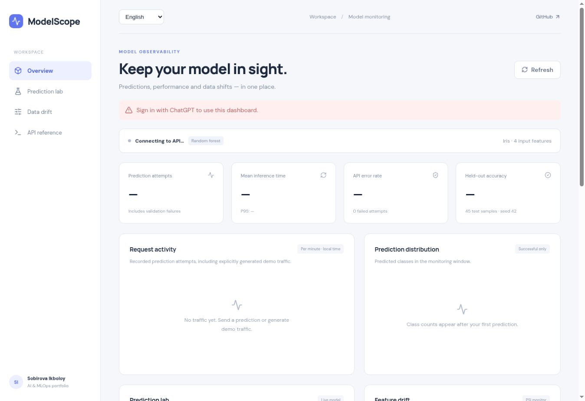
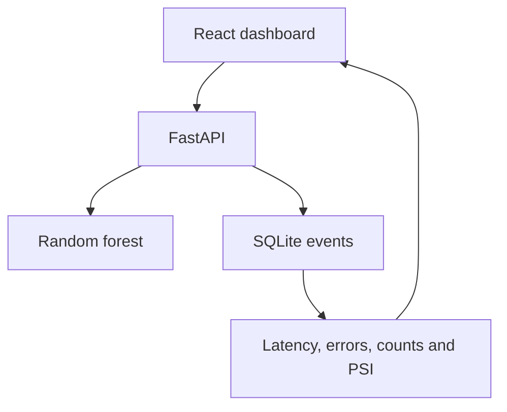

# ModelScope — AI Model Monitoring Dashboard

[](https://github.com/Ikboloy/ai-model-monitoring/actions/workflows/checks.yml)

**Purpose:** make prediction traffic, latency, validation failures and input drift visible for a running ML service.



*Screenshot: local preview of the separately hosted React/Worker adaptation before authentication. Empty metrics and the sign-in notice are intentional; this image is not a successful inference run. The repository below uses FastAPI and SQLite, while the owner-private adaptation uses a Worker and per-user storage. Run the local version below to reproduce model results without a hosted account.*

**Start here:** [Docker](#quick-start-with-docker) · [Local development](#local-development) · [Results](#architecture) · [Reports](#download-monitoring-reports)

A practical **AI / MLOps portfolio project** by **Sobirova Ikboloy**, Computer Engineering graduate of Keimyung University.

ModelScope serves an actual machine-learning model and records its prediction attempts. A React dashboard shows request activity, inference latency, API errors, predicted-class distribution and feature drift. Every displayed monitoring metric is computed from recorded events; demo requests are explicitly tagged.

## What you can do

- Submit four flower measurements to a reproducible Iris random-forest classifier.
- Inspect mean and P95 inference time, error rate and recent prediction attempts.
- Compare current input distributions with training inputs using Population Stability Index (PSI).
- Generate baseline or deliberately shifted demo traffic to explore monitoring behavior.
- Retain event history in SQLite and run the app using Docker Compose.

No paid AI API or API key is required. This is a monitoring project using classical ML, not an LLM chatbot.

## Stack

| Layer | Technology |
| --- | --- |
| Dashboard | React 19, Vite, Recharts, Lucide |
| API | FastAPI, Pydantic, Uvicorn |
| Model | scikit-learn RandomForestClassifier |
| Events | SQLite, bounded retention |
| Packaging | Multi-stage Docker build, Compose |
| Checks | Python unittest, GitHub Actions, frontend build |

## Quick start with Docker

Install Docker with Compose, then run from the repository root:

```bash
docker compose up --build
```

Open **http://localhost:8000** for the dashboard and **http://localhost:8000/docs** for interactive API documentation. Compose binds the application to the local host. Data remains in the `monitoring-data` named volume after container restarts. Stop with `docker compose down`; removing the volume also removes event history.

## Local development

Python **3.12** and Node **22+** are recommended. Use two terminals.

Backend:

```bash
python3 -m venv .venv
source .venv/bin/activate
pip install -r backend/requirements.txt
cd backend
python -m uvicorn main:app --host 127.0.0.1 --port 8000
```

On Windows, activate with `.venv\Scripts\activate` instead. Frontend, from a second terminal at the repository root:

```bash
cd frontend
npm ci
npm run dev
```

Open the URL printed by Vite. Its `/api` proxy forwards requests to the backend. To serve a built dashboard from FastAPI, run `npm run build` inside `frontend`, then restart the backend. The default static path expects the backend working directory shown above.

## A five-minute demo

1. Start with no traffic: charts and latency values show an honest empty state.
2. In Prediction lab, keep `[5.1, 3.5, 1.4, 0.2]` and run a prediction. The model predicts `setosa`.
3. Click **Baseline traffic** to record 50 requests sampled from training inputs.
4. Click **Shifted traffic** to record 50 requests with sepal length increased by 3 cm. These requests are labeled `demo_shifted`.
5. Inspect the PSI values and recent request log. Because the window mixes previous traffic, the amount of visible drift depends on that history.
6. Submit an invalid request through `/docs` or curl to see the error-rate counter change.

```bash
curl -X POST http://localhost:8000/api/predict \
  -H 'Content-Type: application/json' \
  -d '{"sepal_length":5.1,"sepal_width":3.5,"petal_length":1.4,"petal_width":0.2}'
```

## Architecture



The model is trained once per API process at startup. It uses the bundled Iris dataset, a stratified 70/30 train/test split, seed 42, 100 trees and maximum tree depth 5. The 105 training examples supply the drift reference. The 45 test examples are held out of training.

The measured local held-out accuracy was **40/45 (88.9%)** with the pinned dependencies. The API recomputes and reports this value at startup; it is a small benchmark, not a guarantee of future quality. Live prediction accuracy is unavailable because incoming requests have no ground-truth labels.

## API

| Method | Endpoint | Behavior |
| --- | --- | --- |
| GET | `/api/health` | Health and model version |
| GET | `/api/model` | Model metadata and held-out accuracy |
| POST | `/api/predict` | Validated measurements, prediction and latency |
| GET | `/api/metrics` | Monitoring window, sources, trends and drift |
| POST | `/api/demo` | Up to 100 explicitly tagged synthetic predictions |
| GET | `/docs` | Interactive OpenAPI documentation |

Prediction inputs must be finite, greater than zero and no greater than 20 cm. Extra fields are rejected. The maximum accepted value is a validation bound, not the model's training range.

## Monitoring definitions

| Metric | Definition |
| --- | --- |
| Window | Latest 1,000 prediction attempts within the last 24 hours |
| Requests | Successful predictions plus validation and inference failures |
| Error rate | Failed attempts / total attempts |
| Inference latency | Time spent in successful model probability inference; excludes network, input validation and database writes |
| P95 | NumPy 95th percentile of successful inference times |
| Activity | Attempts grouped into observed one-minute buckets; inactive minutes are not backfilled |
| Class distribution | Successful predicted labels only |
| PSI | Smoothed quantile-bin distribution difference against training features |

For rejected inputs, the recent log shows validation time, not inference time. They are excluded from mean/P95 inference metrics. Health, metrics and static page requests are excluded from prediction monitoring.

PSI is calculated after at least **30 successful predictions**, including tagged demo predictions. Five quantile bins are deduplicated and their endpoints cover both tails. A 0.5 pseudocount per bin prevents division by zero. Status thresholds are **0.10 (watch)** and **0.25 (shift)**. These are illustrative heuristics, not statistical significance tests or evidence that accuracy declined. PSI depends on bin choices and sample size.

## Tests and verification

```bash
cd backend
python -m unittest discover -s tests -v
```

Eleven tests cover prediction provenance, validation errors, inference failures, empty metrics, bounded/tagged demo traffic, persistence, the 24-hour window and drift behavior. No external service is needed.

Verified during development:

- Eleven backend tests passed (including three export tests).
- React production build passed.
- Built dashboard was served successfully through FastAPI using TestClient.

Docker could not be executed in the development environment, so the container build is not yet verified. The separately hosted UI has a visual preview above; end-to-end browser interaction for this Python/React checkout and a public deployment of this source have not been verified. The CI workflow checks backend tests and frontend build; it does not test Docker or a live deployment.

## Configuration

| Variable | Default | Purpose |
| --- | --- | --- |
| `MONITOR_DB` | `data/events.sqlite` | SQLite event file |
| `STATIC_DIR` | `../frontend/dist` | Built frontend directory |
| `ENABLE_DEMO` | `1` | Set to `0` to disable demo traffic endpoint |

Up to 10,000 events are retained. Inputs and prediction outputs are stored for this toy dataset. This initial app has no authentication or per-user data separation. Keep it local; add access controls, rate limits, retention policies and a shared database before exposing a multi-user service. Do not send sensitive data to this demo.

## Next improvements

- Ground-truth feedback and delayed live accuracy monitoring
- Model artifact versioning and reproducibility checks
- Authentication, per-user isolation and external-service monitoring
- Prometheus export and alert notifications
- Browser and container integration tests

## References

- [FastAPI testing](https://fastapi.tiangolo.com/tutorial/testing/)
- [RandomForestClassifier documentation](https://scikit-learn.org/stable/modules/generated/sklearn.ensemble.RandomForestClassifier.html)
- [Iris dataset documentation](https://scikit-learn.org/stable/modules/generated/sklearn.datasets.load_iris.html)
- [Vite documentation](https://vite.dev/guide/)
- [Recharts](https://recharts.org/)

## Download monitoring reports

With the backend running, open:

- `http://localhost:8000/api/export/metrics.json` for a timestamped snapshot of model metadata and monitoring metrics.
- `http://localhost:8000/api/export/events.csv` for events in the same latest-1,000 / 24-hour window, newest first.

Both endpoints return downloadable attachments and `Cache-Control: no-store`. Downloads do not create prediction events. CSV includes request IDs, UTC timestamps, status, latency, predicted class/probability and the original user/demo source. Failed requests have empty prediction fields and `failure_processing` latency; successful rows use `inference` latency. Raw input features are not included. Each download is a separate snapshot, so concurrent traffic can change the counts between files.

Exports use the existing local-only access model; no authentication or public deployment is introduced. Three additional backend tests cover empty attachments, success/error/demo provenance, unchanged request counts and expired-event exclusion. No dashboard button has been added; use these URLs or `/docs`.
